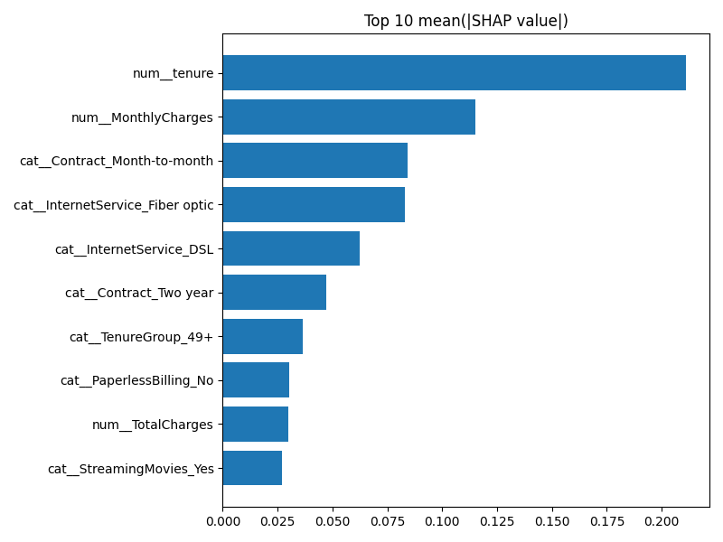
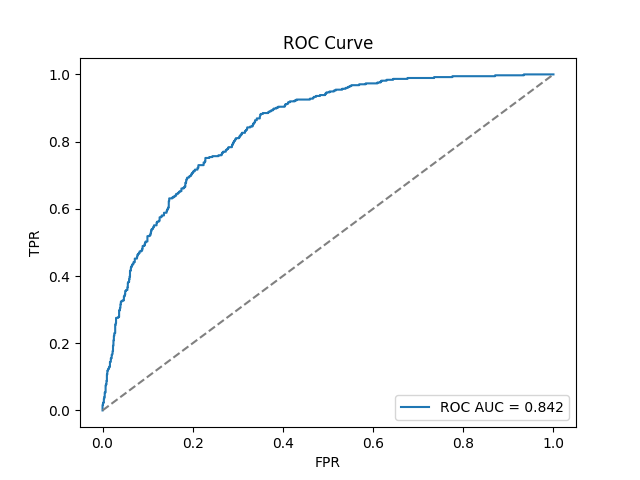

# Customer Churn Prediction

An end-to-end churn pipeline on the Telco Customer Churn dataset. It runs from raw CSV through features, model selection, SHAP explainability and a Streamlit dashboard to a scored export for Power BI.

**Stack:** Python · scikit-learn · XGBoost · SHAP · Streamlit · Power BI · pytest

## Results (held-out test set, 1,409 customers)

| Metric | Score |
|---|---|
| Recall (churners) | **0.79** |
| Precision (churners) | 0.50 |
| F1 (churners) | 0.61 |
| Accuracy | 0.73 |

The model is tuned toward **recall**: catching a churner is worth more than a few false alarms when the follow-up action is a cheap retention offer. Candidates (Logistic Regression, grid-searched Random Forest, XGBoost) are compared by F1, with ROC-AUC as the tie-breaker.

<p>
  
  
</p>

## Quickstart

```bash
cd customer-churn-prediction
python -m venv venv && source venv/bin/activate   # Windows: venv\Scripts\activate
pip install -r requirements.txt

python churn_pipeline.py                  # preprocess → features → train → evaluate → explain
streamlit run dashboard/streamlit_app.py  # interactive scoring
python -m pytest -q                       # tests
```

The full write-up, with the project layout, model details and Power BI integration, is in [`customer-churn-prediction/README.md`](customer-churn-prediction/README.md).
